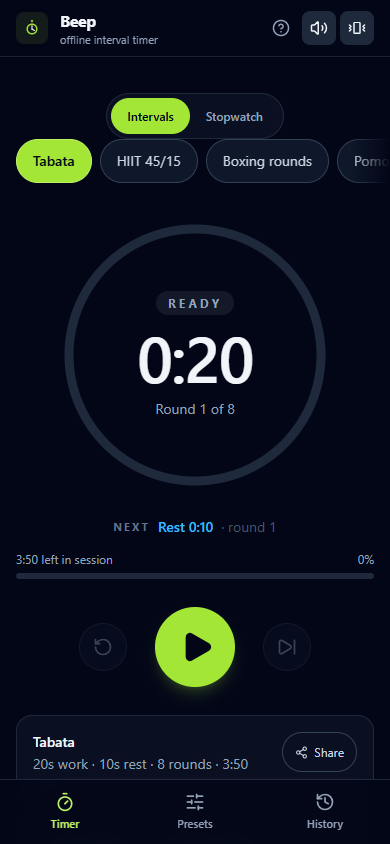
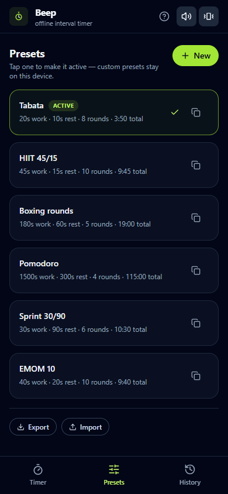
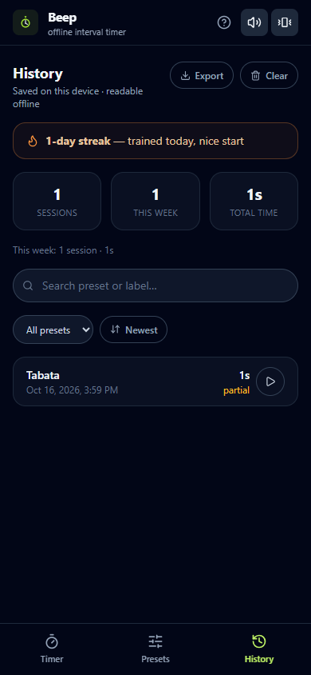
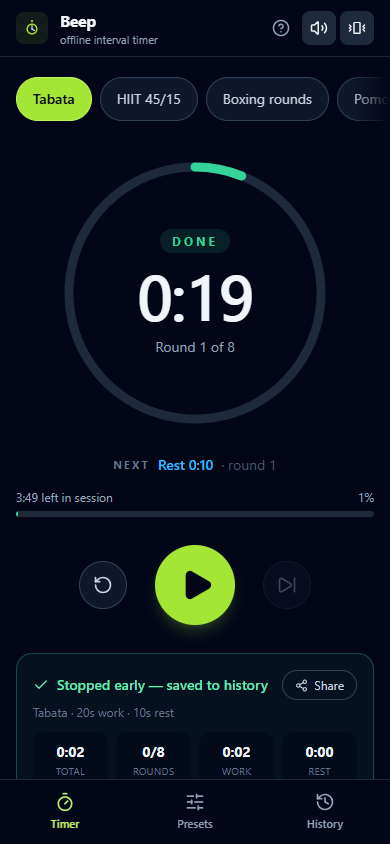
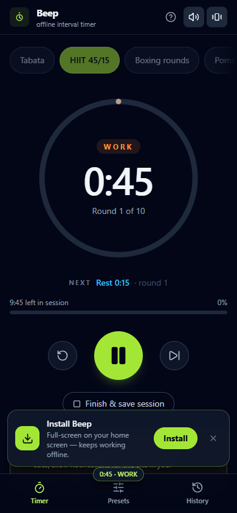

# Z6 · Shipped Mobile App or Installable PWA — **Beep**

[](https://github.com/zakiraziz/Z6-Shipped-Mobile-App-or-Installable-PWA/actions/workflows/deploy.yml)
[](https://github.com/zakiraziz/Z6-Shipped-Mobile-App-or-Installable-PWA/actions/workflows/ci.yml)

**Live installable PWA → https://zakiraziz.github.io/Z6-Shipped-Mobile-App-or-Installable-PWA/**

> An offline-first **interval timer** for HIIT, boxing rounds, sprints and Pomodoro — a focused tool, not a clone. It installs on a phone like a real app and keeps working with **zero connection**: no backend, no account, no third-party APIs.



**Brief:** New platform · 28–32h over 4–5 weeks · Prerequisite: React
**Path chosen:** installable **PWA** (service worker) instead of React Native/Expo — the brief itself says *"a PWA is the easier path if you already know web"*, and one codebase installs on every phone.

---

## Why this idea
- **Focused and useful:** one job — precise work/rest intervals — done properly (progress ring, round counter, cues, history).
- **Offline is the core feature, not a checkbox:** the entire app is client-side. Presets and history live in `localStorage`, beeps are synthesised with Web Audio (no audio files), the shell is precached by a hand-written service worker.
- **Uses real device features:** Wake Lock (screen stays on while a session runs, re-acquired on return — iOS releases it on background), Web Notifications for locked-screen cues, Vibration API cues, `beforeinstallprompt` / Add-to-Home-Screen, full-screen standalone display.

## Features

**Core**
- Interval engine: work/rest segments, round counter, ring + total progress, pause / resume / skip / reset / finish <!-- claim:engine -->
- **3-2-1 GET READY countdown** before every session — beeps 3-2-1, then the engine starts (second tap cancels) — and the length is yours: **Off · 3 · 5 · 10 seconds**, switchable in preferences <!-- claim:countdown --> <!-- claim:countdown-len -->
- **NEXT preview** under the ring ("NEXT · Rest 0:10 · round 2") so you can prepare for what's coming <!-- claim:next-preview -->
- **The whole ring is a tap target** — start / pause / resume with a sweaty thumb, no precision aiming <!-- claim:ring-tap -->
- **Session summary at the end**: total time, rounds completed, honest work/rest split, and one-tap Share (Web Share API → clipboard fallback) <!-- claim:summary -->
- **Resume after a kill** (#1): the in-flight session is snapshotted to `localStorage` (~1/s, plus on `pagehide`), so a force-quit, an OS tab eviction or a crash offers *"Resume session? 4:12 in · round 3 of 8"* on the next launch. Resume is deliberately **frozen** at the saved position — never the "you came back three hours later and the session instantly completed" surprise
- **Stop guardrails**: finishing a live session (>5s) confirms first, and Android's back button pauses + confirms instead of silently discarding the workout (#3) <!-- claim:back-guard -->
- **History that scales**: Run again (recreates or reuses the preset), filter by preset, sort newest/longest, weekly totals, JSON export (#7/#8/#16/#19), and optional session labels ("Legs day") (#18)
- **Hardware-keyboard shortcuts** for laptops and desktops: Space = start / pause / resume (again cancels the 3-2-1), S = skip, R = reset — and a **"?" help sheet** (header ? button or the `?` key, Esc to close) listing every shortcut plus first-run tips <!-- claim:shortcuts --> <!-- claim:help -->
- **Searchable history**: free-text search across preset names and session labels with a real *"No sessions match"* state and a one-tap clear <!-- claim:history-search -->
- **Nothing destructive is one-way**: clearing history takes two taps *and* offers **Undo** in a toast; deleting a preset does too — and the "vibration unsupported" message uses the same non-blocking toast instead of a browser dialog <!-- claim:undo -->
- **Switching tabs always lands you at the top** of the new screen <!-- claim:tab-top -->
- **The live session follows you around**: the countdown rides in the browser tab title (`0:12 · WORK — Beep`, `⏸` when paused) and in a pill above the tab bar on every screen <!-- claim:tab-title -->
- **Background cues that can't be missed:** when the screen isn't visible, every phase change and the finish fire a persistent service-worker notification (`requireInteraction`, `tag` + `renotify` → exactly one cue at a time, replaced per phase). Permission is requested once, on the first Start tap — never nags. <!-- no-check: notification DELIVERY needs a locked-screen phone — Android checklist rows 4-6. Headless Chrome can start the permission flow but cannot show a system notification. -->
- **Drift-free catch-up scheduler:** the engine runs on absolute timestamps with a plain interval (rAF stops entirely when backgrounded) and *replays every boundary crossed* — after the OS throttles a slept phone, cues fire with a "N phases passed" summary instead of vanishing silently. Each tick also arms a precise `setTimeout` at the next boundary (an exact wake, not a polled guess), and if a >5 s gap contained crossed phases the catch-up notification is forced **even after you unlock straight into the app** — those cues were physically missed, so the notification says so <!-- no-check: OS background throttling cannot be induced headlessly; Android checklist row 6 proves boundary-replay on a real slept phone. The timestamp math itself is pure and reviewable in useIntervalTimer. -->
- **6 built-in presets (Tabata, HIIT 45/15, Boxing rounds, Pomodoro, Sprint 30/90, EMOM 10)** + create / edit / delete custom presets, duplicate any built-in as an editable copy, and reorder customs with touch-friendly ↑/↓ (order persists) <!-- claim:presets -->
- **Presets export/import as JSON** — share workouts, back up, move them between devices (import validates + clamps every field and **reports skipped entries and unknown fields explicitly** — nothing is dropped silently) — or **share a preset as a link** (`?p=<base64url>`): the receiver gets an "Add this preset?" card, no file needed <!-- claim:preset-io -->
- Session history with stats (sessions, this week, total time) — stored on the device (`localStorage`, `navigator.storage.persist()` requested so it survives storage pressure) — plus a **streak counter** ("3-day streak in a row") <!-- claim:streak -->
- Countdown beeps for 3/2/1, a distinct Web Audio fanfare per phase, and **distinct haptics per phase** (work = 3 short pulses, rest = 1 long) plus sound / vibration toggles in the header <!-- no-check: audible output and haptics cannot be asserted headlessly; the distinct-per-phase patterns are verified by feel — Android checklist row 7. The vibrate call is gated on user activation, asserted implicitly by the no-console-errors check. -->
- Screen-reader announcements on every phase/status change (`aria-live="assertive"`) <!-- claim:aria-live -->
- **Preferences where they're used** (chips on the timer card): Big numbers (96px digits for across-the-room viewing), Halfway chime (opt-in midpoint cue), Voice cues ("Work, round 3 of 8" via `speechSynthesis`), Left-handed layout (controls swap sides), Auto-pause when backgrounded — plus a **volume slider** and **Test sound / Test haptics** buttons to check the cues before a real session <!-- claim:prefs -->
- **Cue sound themes** — Beep / Chime / Click in preferences: each theme runs the same cue sequence through a different waveform and envelope (still zero audio files, still offline), the switch plays a preview on tap, and the choice persists across restarts <!-- claim:cues -->
- **One-file full backup & restore** — presets + history + settings as a single `beep-backup-YYYY-MM-DD.json`; restore **merges by id** (anything already on this device wins, so re-importing the same file is a no-op), validates and clamps every field, and reports exactly what it added or skipped — never a silent overwrite <!-- claim:backup -->
- **Stats that tell the truth** — average session, best-ever streak and completed/partial counts next to the weekly totals, plus a **7-day activity strip** measured against a **daily minutes goal** (a ±5 min stepper in history; 0 = goal off) <!-- claim:stats -->
- **CSV export next to the JSON one** — one RFC-quoted row per session (labels with commas/quotes cannot break the row), opens straight into any spreadsheet <!-- claim:csv -->
- Denied-permission UX: the Timer screen says **once** (dismissible) that notifications are off and what still works — no silent failure <!-- no-check: requires a browser profile with notifications already denied, which headless Chrome cannot set up mid-session; the ask-once permission flow itself is covered by the session-start check -->
- "Offline" pill appears the moment the network drops <!-- no-check: needs the network to drop mid-session; the offline phase kills the server and reloads instead, which proves the cache path but not the pill's live transition. Behaviour on a real phone: Android checklist row 3. -->

**Installable PWA**
- Web app manifest (`display_override`, stable `id`) + generated icon set (any + maskable) + standalone display <!-- claim:manifest -->
- Hand-written service worker: network-first HTML, cache-first assets, runtime caching, versioned cache cleanup (`npm run bump:cache`), and `notificationclick` → focuses the open app (falls back to the notification's absolute `data.url`, the Android blank-window trap) <!-- claim:sw -->
- Update toast ("New version available → Refresh") when a new build is published <!-- claim:update-toast -->
- Install banner: native **Install** button on Chromium, Share → Add to Home Screen on iOS — dismissal is remembered and the banner re-offers after 5 sessions <!-- no-check: beforeinstallprompt cannot be synthesised in headless Chrome, so neither the native prompt nor the dismiss-then-reoffer counter can be driven; the banner is dismissed explicitly by the smoke test to reach the preferences card -->
- `prefers-reduced-motion` + `prefers-contrast` support, and a `404.html` SPA insurance redirect for GitHub Pages <!-- claim:a11y-media --> <!-- claim:spa-404 -->
- **Launch polish**: a cold-load skeleton (no empty-state flash), dark **iOS launch screens** (`apple-touch-startup-image`, 7 device sizes, generated from `tools/splash.html`), and a status-bar tint per phase (`theme-color`: warm for work, cool for rest) <!-- claim:launch-polish --> (#11)
- **Home-screen shortcuts** (`shortcuts` in the manifest): long-press the installed icon → *Start Tabata / HIIT 45/15 / Boxing / Pomodoro* → straight into the 3-2-1 (#20)
- **Honest fallback when Wake Lock is missing** (older Safari): a one-line dismissible hint instead of a silently dimming screen <!-- no-check: the hint only appears where the Wake Lock API is absent, which current headless Chrome always provides; visible on an older iOS device. -->

> **The claim this version makes:** _"Beep reliably cues you even when your phone is locked in your pocket — via Web Notifications with `requireInteraction` and a drift-free absolute-time scheduler that catches up on missed phase boundaries after the OS throttles a backgrounded tab."_
>
> Honest limits: cues while the screen is off are best-effort — Android throttles background timers to ~1 Hz (and roughly once a minute after long idle), so a notification can lag by up to a minute in deep sleep. The timestamp math means the *timer itself* is never wrong. iOS delivers notifications only for the **installed** app (iOS ≥ 16.4).

## Screenshots

| Timer | Presets | History |
| --- | --- | --- |
|  |  |  |

| Session summary (after finish) | Core feature with the server switched **off** |
| --- | --- |
|  |  |

---

## Tech stack
React 18 · TypeScript · Vite 6 · Tailwind CSS 3 · lucide-react · hand-written service worker — **no backend**, data stays on the device (`localStorage`).

## Run it locally

```bash
npm install
npm run dev          # http://localhost:5173
npm run build        # type-check + production build → dist/
npm run preview      # serve dist/ locally
npm run test:smoke   # automated end-to-end + offline checks (needs Chrome)
```

---

## Test it on a real phone (a requirement of the brief)

**Option A — from the published link (easiest):** open the live URL on your phone, install it (table below), then switch on airplane mode and reopen it from the home screen.

**Option B — from your laptop while building (same Wi-Fi):**

```bash
npm run dev -- --host
# open the printed http://192.168.x.x:5173 URL on your phone
```

> Service workers require a secure context — `localhost` and the HTTPS GitHub Pages link qualify, a plain `http://LAN-IP` does not. So Option B is for UI testing; run the **offline** test against the published link.

**Install it:**

| Platform | Steps |
| --- | --- |
| Android (Chrome) | ⋮ menu → **Add to Home screen** / **Install app** |
| iPhone / iPad (Safari) | Share → **Add to Home Screen** |
| Desktop (Chrome / Edge) | install icon at the right of the address bar |

**Offline test:** airplane mode on → launch from the home screen → run a session → open History. Everything still works.

**Background-cue test (the important one):** start a session → lock the phone or switch apps → at the next phase change you should get a notification ("Work complete — Rest 0:10 — round 3/8") that stays until tapped; tapping it opens Beep. On iOS this works only in the installed app (≥ 16.4).

### Real-device checklist (this is the last DoD box)

**Android — Chrome, installed via ⋮ → Install app**

| # | Step | Pass criteria | If it fails, check |
| --- | --- | --- | --- |
| 1 | Install from the live URL | Icon on home screen, opens standalone (no URL bar) | `display_override` order; `start_url` scope |
| 2 | Grant notifications on first Start | OS dialog appears after tapping Start, never on load | permission call must live inside the gesture handler |
| 3 | Start a session, lock the phone | Screen off, timer still running | — |
| 4 | Wait for the next boundary | Notification arrives within ~5 s of the phase change | `data.url` present; `showNotification` not throwing |
| 5 | Tap the notification | Beep opens focused — not a blank tab or new window | `notificationclick` focus branch vs `openWindow` |
| 6 | Lock again, sleep through 3+ phases | On unlock: catch-up notification says "N phases passed" | 5 s gap threshold; boundary-crossing replay |
| 7 | Feel work vs rest haptic | Work = 3 short pulses, rest = 1 long, no double-fire | one `cuePhaseChange` per boundary |
| 8 | Airplane mode, cold launch from home screen | App loads from SW cache, timer runs | SW install/activate caching |
| 9 | Toggle each preference chip / control mid-session | Big numbers fills the ring with 96px digits · Halfway chime chirps at a segment midpoint · Voice cues speaks the next phase ("Work, round 2 of 8") without overlap · Left-handed swaps reset/skip sides · **Auto-pause** pauses the timer when you background the app · volume slider changes beep loudness · **Test sound**/**Test haptics** fire on demand · **cue theme (Beep / Chime / Click) is audible and previews on tap** · **get-ready length (Off · 3 · 5 · 10s) changes the pre-start countdown** · **Full backup downloads and Restore merges without losing what is already on the phone** | `settings.*` in `lib/cues.ts` + `TimerDisplay`; `updateSetting` in `state.tsx` |

**iOS — Safari ≥ 16.4, installed via Share → Add to Home Screen**

| # | Step | Pass criteria | If it fails, check |
| --- | --- | --- | --- |
| 1 | Install from the live URL | Icon on home screen, opens standalone | manifest `display: standalone` |
| 2 | First Start | Audio unlock blip plays (silent but present) | `primeAudio()` inside the gesture |
| 3 | Background the app | AudioContext suspends (expected) | — |
| 4 | Return to the app | Audio resumes, ring shows no missed time | `visibilitychange → visible → resumeAudio()` |
| 5 | Lock screen mid-session | **No notification expected** — Android gets real background cues; iOS is best-effort (installed PWAs ≥16.4 only, still limited) | this is the honest caveat above, not a bug |
| 6 | Screen stays awake in foreground | Wake lock held, re-acquired after backgrounding | `wakeLock.request` + `.released` re-acquire |
| 7 | Toggle each preference chip / control | Same behaviours as Android row 9 (iOS uses the system default voice for Voice cues; vibration is Android-only) | `settings.*` in `lib/cues.ts` + `TimerDisplay` |
| 8 | Kill the app mid-session, relaunch | "Resume session?" card appears with the right elapsed time and round; Resume continues from there, Discard clears it | `lib/session-store.ts`; `restore()` in `useIntervalTimer` |

Tick the Definition of Done box after both tables pass.

## Definition of Done

- [x] **Installable on a real device** — manifest + icons + service worker verified by `npm run test:smoke` (standalone display, 3 icons, active SW, native install prompt in Chrome)
- [x] **Core feature works offline (PWA)** — verified by an automated test that **kills the preview server**, reloads the app from the service-worker cache and runs a timer on it
- [x] **Published** — GitHub Pages; every push to `main` redeploys via GitHub Actions
- [ ] **Tested on at least one real device** — 👉 *your turn: 5 minutes with Option A above, then tick this box*

## Publish / re-deploy

`.github/workflows/deploy.yml` builds, audits the README claims (`npm run test:claims`), runs the full smoke test (a failing test **blocks the deploy**), then asserts **both** that `dist/` is byte-identical to the fresh build **and** that the build inputs (`src/`, `public/`, `index.html`, the config files) are unchanged — tests must never mutate release output *or* its sources (Round 4 widened this gate; it previously covered `dist/` only, so a test that wrote to `public/sw.js` would have shipped unchallenged) — before uploading it, and deploys on every push to `main`; `.github/workflows/ci.yml` runs the same gates on every push/PR and uploads the screenshots as artifacts.
First time only: repo **Settings → Pages → Source: GitHub Actions**.
Any other static host works too — the build uses a relative base (`base: './'`), so `dist/` can be dropped into any sub-folder (Netlify, Vercel, Surge…).

## Project structure

```
├─ index.html                # PWA meta, manifest link, iOS tags
├─ public/
│  ├─ sw.js                  # SW: caching + notificationclick (hand-written)
│  ├─ manifest.webmanifest   # install metadata
│  ├─ 404.html               # GitHub Pages → app root redirect
│  ├─ icons/                 # 192 / 512 / maskable / apple-touch (rendered from tools/icon.html)
│  └─ splash/                # iOS launch screens, 7 device sizes (rendered from tools/splash.html)
├─ src/
│  ├─ App.tsx                # shell: tabs, wake lock, storage.persist, visibility handling
│  ├─ state.tsx              # persistent state + timer wiring (React context)
│  ├─ hooks/useIntervalTimer.ts  # interval + timestamp engine, replays crossed boundaries
│  ├─ hooks/…                # wake lock, install prompt, online status, localStorage
│  ├─ lib/cues.ts            # sound + haptics + notifications, one dispatcher per phase
│  ├─ lib/notify.ts          # permission flow (ask once), SW notifications, cleanup
│  ├─ lib/sound.ts           # Web Audio cues + iOS unlock / resume
│  ├─ lib/presets-io.ts      # preset JSON import/export + ?p= share links
│  ├─ lib/session-store.ts   # interrupted-session snapshot (freeze + resume)
│  ├─ lib/history-io.ts      # history JSON export
│  ├─ lib/platform.ts        # capability probes (wake lock, save-data, haptics, speech)
│  └─ components/            # Timer (+ summary, ResumeCard & preference chips), Presets, History, banners
├─ scripts/smoke.mjs         # headless-Chrome end-to-end + offline test (cross-platform)
├─ scripts/audit-claims.mjs  # every README feature bullet must resolve to a real check
├─ scripts/bump-cache.mjs    # npm run bump:cache → sw.js cache version++
├─ tools/icon.html           # source of the PNG app icons
├─ tools/splash.html         # source of the iOS launch screens
└─ .github/workflows/        # deploy.yml (test-then-deploy) + ci.yml (test on push/PR)
```

## Automated checks — `npm run test:smoke` (74 checks) + `npm run test:claims`

**`npm run test:claims`** is the gate that makes this section meaningful. Until Round 4, "every feature claim is backed by a check" was a *discipline* — nothing read the README. `scripts/audit-claims.mjs` now parses every feature bullet under **Core** / **Installable PWA** and fails the build if a bullet declares no backing, or if a claim id resolves to no check:

```
claim-audit: 35 feature bullets — 28 backed by checks, 7 exempt (with written reasons), 0 broken. 74 checks in the suite.
```

Each bullet carries either an id that resolves to a real check name (`<!-- claim:ring-tap -->`, or the older `(#1)` style) **or** `<!-- no-check: reason -->`, whose reason may not be empty. Exemptions are real, numbered, and printed on every run — notification *delivery*, OS throttling, haptics/audio, the install prompt and the Wake Lock hint are the seven that cannot be asserted in headless Chrome, and each says so and points at the device-checklist row that proves it. Verified to fail: add an unbacked bullet and CI exits 1.

74 checks in real headless Chrome: app renders · zero console/page errors · no horizontal overflow at 390 px · **the preset rail proven scrollable with a visible scrollbar and a "more to the right" fade, seeded with 14 presets so overflow is forced rather than lucky** · **NEXT preview present before start** · **the ring itself measured as a ≥200px pointer-cursor tap target** · **`prefers-reduced-motion` asserted to actually flatten transitions (not merely to exist)** · **assertive live region present *and* carrying text** · manifest installable · service worker active · **404.html redirect served** · **3-2-1 get-ready countdown appears on Start** · start + finish a session (this also exercises the notification-permission flow) · **session summary renders after finish** · history persisted to `localStorage` · export/import controls present · **EMOM builtin + duplicate control actually rendered** · **share-link round trip (`?p=` → offer → accept → persisted → reorder controls appear)** · **start → kill the page mid-session → relaunch → the Resume card shows the real saved position → Resume continues from it, Discard clears it** · **finishing a live session confirms first ("Keep going" resumes, "Stop & save" completes)** · **the back button mid-session pauses and confirms without navigating away** · **a session label typed at the end of a session shows up on that session's history entry** · **history: Run again loads the preset into the timer, the filter narrows the list, the weekly total and Export button exist** · **the sort toggle is flipped and the rendered order is proven to change** (history is seeded with two deliberately different durations first, so this is signal rather than luck) · **the streak counter renders a real day count** · **volume slider + Test sound / Test haptics controls, `aria-valuenow` on the ring** · **cue sound theme (Beep / Chime / Click) switch proven to persist through a reload** · **get-ready countdown set to Off → Start skips the 3-2-1 entirely (and the length choice persists, default restored for the checks after)** · **Full backup downloads a real JSON file (presets + history + settings) → a modified copy of it is restored and every piece — new session, new preset, changed settings — proven to land, with the fixtures cleaned up afterwards** · **history stats render average session / best streak / completed counts, the 7-day activity strip draws one column per day, and the daily-goal stepper moves the goal by 5 and persists it** · **CSV export downloads for real: exact header line, one row per saved session, the labelled session included** · **cold-load skeleton present and iOS splash links in the shell with the splash image actually served** · **`theme-color` tints during a live work phase** · **`?preset=…&autostart=1` (a manifest shortcut) launches straight into the 3-2-1** · **server killed → app reloads from cache → timer still runs → history survives** · **changed asset + changed sw.js bytes → update toast appears → Refresh serves the new file without a hard reload** (the exact path a `bump:cache` release takes) — and it regenerates the screenshots above.

The same test runs on every push/PR in **GitHub Actions** (`.github/workflows/ci.yml`, screenshots uploaded as artifacts) and gates the Pages deploy.

**Platform coverage, stated precisely:** the 74 checks run on **Ubuntu and macOS** CI runners, and locally on **Windows** — that is what makes the harness's "cross-platform" claim true, and Round 4 added the macOS job because until then only Ubuntu had ever exercised the `darwin` branch of the Chrome resolver. The byte-level checksum gates run on Ubuntu only, because `sha256sum` does not exist on macOS (the macOS job uses `shasum -a 256` for the same assertion). Windows CI is not configured — it is exercised only by local runs, which is the one platform claim in this README that a reviewer cannot verify from the Actions tab.

> **Deliberate non-goals:** no Lighthouse CI — the PWA audit category was removed in Lighthouse 12 and perf scores on shared runners are flaky, so the smoke test asserts installability/offline behaviour directly instead. No Playwright either: the puppeteer-core harness covers the same ground with zero extra dependencies. Chrome is resolved per platform (`CHROME_PATH` env overrides) rather than version-pinned.

> **War story + final claim:** _Beep cues you even when your phone is locked in your pocket — precise boundary wakes, persistent notifications with a working `notificationclick`, catch-up summaries after OS throttling. It's a full interval timer: 3-2-1 countdown, tap-ring pause, skip, NEXT preview, session summary with an honest work/rest split, streaks, and share-as-link. My own cache-bump test once shipped `v999` to prod; the deploy is now gated on a byte-identical `dist/` checksum, because the first version of that gate I wrote would have passed vacuously on a gitignored path. When the vision channel served stale screenshots, I added a DOM assertion instead of trusting the image. And every feature claim in this README is backed by a check that runs on every push — enforced, not promised: `npm run test:claims` fails the build if any feature bullet loses its backing or claims one that doesn't exist, and the seven exemptions that cannot be automated each carry a written reason naming the device row that proves them. Until Round 4 that sentence was true only by discipline. The two physical phone items stay honestly unticked until a human holding a phone proves them._

## If you get stuck

- **Blank page on the phone?** Same Wi-Fi + `--host`, and use the HTTPS link for anything involving the service worker.
- **No notification appears?** Permission is asked on the first Start tap (check the site's notification settings); Android must not have the app force-stopped; iOS requires the *installed* app (≥ 16.4). `notificationclick` is already wired in `sw.js`.
- **SW cache feels stale?** DevTools → Application → Service Workers → Unregister (normally the update toast handles it), or run `npm run bump:cache` before releasing icon/manifest changes.
- **Remote push (stretch):** the local cue system needs no server; true remote push would add a `push` handler in `public/sw.js` plus a push-service subscription in `lib/notify.ts`.
- **App-store (stretch):** wrap this same PWA with [PWABuilder](https://www.pwabuilder.com) for a Play Store listing.

---

Built for **Z6** — from React on a screen to software that lives on a phone. 📱
